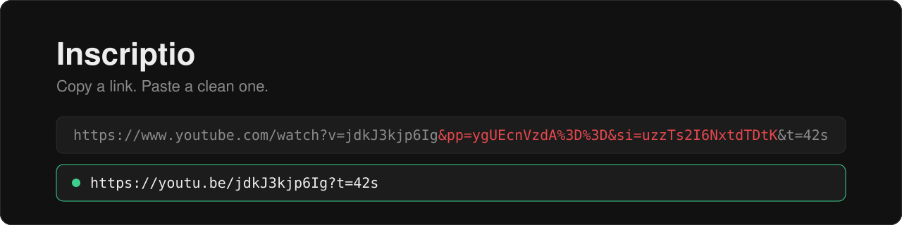
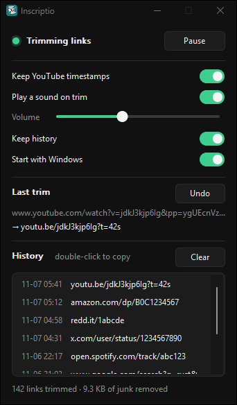
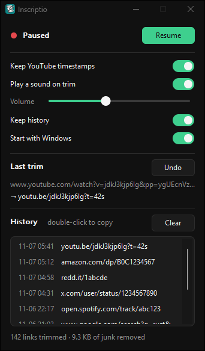
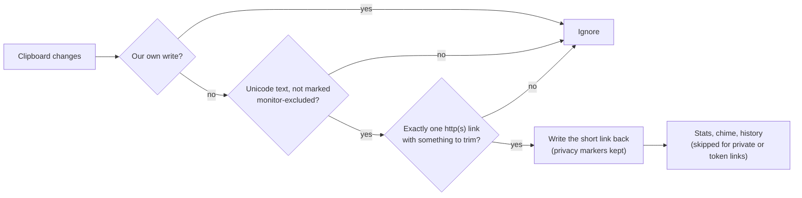

<div align="center">
  
  <h1>Inscriptio</h1>
  <p>A tiny Windows tray app that strips tracking junk from links the moment you copy them.</p>

  <!-- TODO: once a GitHub release exists, add: <a href="https://github.com/projectGloria/Inscriptio/releases"></a> -->
  
  
  
</div>

<p align="center">
  
</p>

<p align="center">
  <a href="#features">Features</a> ·
  <a href="#screenshots">Screenshots</a> ·
  <a href="#what-gets-trimmed">What gets trimmed</a> ·
  <a href="#installation">Installation</a> ·
  <a href="#usage">Usage</a> ·
  <a href="#building-from-source">Building</a>
</p>

## About

Inscriptio sits in the notification area and watches the clipboard. When you copy a single http(s) link, it rewrites it in place: tracking parameters go, and links from sites it knows get their short canonical form (`youtu.be/…`, `redd.it/…`, `amazon.com/dp/…`). Paste as usual and the clean link is what comes out.

It is a single native Rust executable using the Win32 API directly. No runtime, no web view, no background polling: it sleeps until Windows reports a clipboard change.

## Features

- **Rewrites in place.** Copy a link, paste a clean one. Text that isn't exactly one link (prose, several links, `mailto:`) is never touched.
- **Site-aware rules.** Canonical short links for YouTube, Reddit, Amazon, eBay, AliExpress and X/Twitter, plus junk removal for Spotify and Google Search. Everything else gets a generic strip of `utm_*`, `fbclid`, `gclid`, `igsh` and similar.
- **Keeps what matters.** YouTube playlists and positions (`list`, `index`) survive; the start time (`t=`) is kept or dropped with a switch.
- **Undo.** Restore the original link from the tray menu or the settings window.
- **History you control.** The last 50 trimmed links, double-click to copy again. Links copied from incognito windows and links that look like they carry a token (`code=`, `access_token`, long reset IDs) are never recorded.
- **Respects password managers.** Copies marked as excluded from clipboard monitors are not even read, and Windows clipboard-history and cloud-sync opt-outs are carried over to the rewritten link.
- **Small and quiet.** Event-driven (0% CPU when idle), single instance, dark per-monitor-DPI settings window, optional synthesized chime with volume control, and a red badge on the tray icon while paused.

## Screenshots

<table>
  <tr>
    <td align="center"></td>
    <td align="center"></td>
  </tr>
  <tr>
    <td align="center"><em>Settings: switches, the last trim with Undo, and history.</em></td>
    <td align="center"><em>Paused: one click on Resume turns trimming back on.</em></td>
  </tr>
</table>

<sub>Screenshots use demo history and stats.</sub>

## What gets trimmed

Examples taken from the unit tests in [`src/rules.rs`](src/rules.rs):

| You copy | You paste |
| --- | --- |
| `https://youtu.be/jdkJ3kjp6Ig?si=uzzTs2I6NxtdTDtK` | `https://youtu.be/jdkJ3kjp6Ig` |
| `https://www.youtube.com/watch?v=jdkJ3kjp6Ig&list=PL123&index=3&si=x` | `https://youtu.be/jdkJ3kjp6Ig?list=PL123&index=3` |
| `https://music.youtube.com/watch?v=jdkJ3kjp6Ig&si=x` | `https://music.youtube.com/watch?v=jdkJ3kjp6Ig` |
| `https://www.reddit.com/r/rust/comments/1abcde/some_title/?utm_source=share&share_id=x` | `https://redd.it/1abcde` |
| `https://twitter.com/user/status/1234567890?s=20&t=abc` | `https://x.com/user/status/1234567890` |
| `https://www.amazon.com/Some-Product-Name/dp/B0C1234567/ref=sr_1_3?crid=X&keywords=y` | `https://amazon.com/dp/B0C1234567` |
| `https://www.ebay.com/itm/cool-thing-name/123456789012?_trkparms=x&hash=y` | `https://ebay.com/itm/123456789012` |
| `https://open.spotify.com/track/abc123?si=zzz` | `https://open.spotify.com/track/abc123` |
| `https://www.google.com/search?q=rust&sca_esv=1&ei=2&udm=14` | `https://www.google.com/search?q=rust&udm=14` |
| `https://example.com/a?id=5&utm_source=x&UTM_Medium=y&fbclid=z#sec` | `https://example.com/a?id=5#sec` |

Reddit comment permalinks keep their full path (redd.it can't address comments), and anything longer than 4096 characters is left alone.

## How it works



The rewrite rules in [`src/rules.rs`](src/rules.rs) are pure functions with no Win32 code, so they run under `cargo test`. The clipboard layer ([`src/clipboard.rs`](src/clipboard.rs)) remembers the sequence number of its own writes so it never re-trims its output or loops with another clipboard tool.

## Installation

**Requirements:** Windows 10 version 1703 or later, x64.

<!-- TODO: publish dist\Inscriptio-0.3.0-setup.exe as a GitHub release so this link has something to download. -->
1. Download `Inscriptio-<version>-setup.exe` from the [Releases](https://github.com/projectGloria/Inscriptio/releases) page, or [build it yourself](#building-from-source).
2. Run it. It installs per user to `%LOCALAPPDATA%\Programs\Inscriptio`, so no administrator prompt.
3. Choose whether to start Inscriptio with Windows and whether to add a desktop shortcut.

Uninstalling removes the program, its settings, its history and the autostart entry.

## Usage

- **Trim a link:** just copy it. With the chime on, you hear when a link was rewritten.
- **Open settings:** left-click the tray icon, or launch Inscriptio from the Start menu (it opens the running copy's window).
- **Tray menu (right-click):** Pause / Resume, Undo last trim, Settings…, Exit.
- **Reuse a link:** double-click a row in History to copy it again.
- **Close the window:** press <kbd>Esc</kbd>. Inscriptio keeps running in the tray.

<details>
<summary>Command-line flags</summary>

| Flag | Effect |
| --- | --- |
| `--settings` | Open the settings window on start. If Inscriptio is already running, the running copy opens it instead. |
| `--trace` | Log every clipboard decision to `%TEMP%\inscriptio.log`. Quit the tray copy first: only the first instance listens. |

</details>

<details>
<summary>Where data is stored</summary>

| What | Where |
| --- | --- |
| Settings and stats | `HKCU\Software\Inscriptio` |
| Start with Windows | `HKCU\Software\Microsoft\Windows\CurrentVersion\Run`, value `Inscriptio` |
| History (trimmed links only, max 50) | `%LOCALAPPDATA%\Inscriptio\history.tsv` |

</details>

## Building from source

**Prerequisites**

- Rust 1.88 or newer (2024 edition, uses let-chains) with the `x86_64-pc-windows-msvc` toolchain
- Visual Studio Build Tools with the Windows SDK (`rc.exe` embeds the icon and manifest)
- For the installer only: [Inno Setup](https://jrsoftware.org/isinfo.php) 6.7 or newer (`winget install JRSoftware.InnoSetup`)

**Steps**

1. Clone the repo:
   ```powershell
   git clone https://github.com/projectGloria/Inscriptio.git
   cd Inscriptio
   ```
2. Run the tests:
   ```powershell
   cargo test
   ```
3. Build the executable. Output: `target\release\inscriptio.exe`.
   ```powershell
   cargo build --release
   ```
4. Optional, build the installer. Output: `dist\Inscriptio-<version>-setup.exe`. The version comes from `Cargo.toml`.
   ```powershell
   & .\installer\build.ps1
   ```

## Contributing

Issues and pull requests are welcome. New site rules belong in [`src/rules.rs`](src/rules.rs) together with a test case showing the input and the expected output. Please run `cargo test` before opening a pull request.

## License

<!-- TODO: add a LICENSE file and name the license here. -->
No license file has been added yet.
